# Wordward งาน 01 · หน้าจอทายคำ ภาษา ธีม และยืนยันเริ่มรอบวันนี้ใหม่

รายงานและเอกสารส่งมอบของสมาชิกคนที่ 1 (branch `member/01-ui` · [Issue #1](https://github.com/Micosz/CS364FinalApplication/issues/1)) อ้างอิงขอบเขตจาก [ข้อตกลงทีมฉบับล่าสุด](TEAM_AGREEMENTS.md) (คลังคำหลักประมาณ **1,000 คำ**, **31 โจทย์รายวัน** ตามเขตเวลา `Asia/Bangkok`, และฟีเจอร์ **เริ่มรอบวันนี้ใหม่**) และ [ใบงานคนที่ 1](01-ui.md)

> **ขอบเขตไฟล์ที่แก้ในงานนี้**:
> - `app/src/main/java/th/ac/tu/cs364/wordward/GameScreen.java`
> - `app/src/main/res/layout/activity_game.xml`
> - `app/src/main/res/values/strings.xml`
> - `app/src/main/res/values-th/strings.xml`
> - `app/src/main/res/values/colors.xml`
> - `app/src/main/res/values-night/colors.xml`
> - `app/src/main/res/values/themes.xml`
> - `app/src/main/res/values-night/themes.xml`
> - `app/src/test/java/th/ac/tu/cs364/wordward/GameScreenTest.java`
> - `docs/team/WORDWARD_01_UI.md`
> - `docs/team/screenshots/01-ui/*.png` (ชุดภาพหลักฐานจาก Emulator จริง 13 ภาพ)
>
> *(ไม่แก้ไขไฟล์ของสมาชิกส่วนที่ 2, 3, 4, 5 โดยคงความเข้ากันได้ย้อนหลังกับ `GameActivity.java` บน `main` 100%)*

---

## 1. กลไกหลักของ `GameScreen` และส่วนติดต่อผู้ใช้ (Rubric ข้อ 2.1)

`GameScreen` ทำหน้าที่เป็นชั้นแสดงผล (Presentation / View Layer) ที่รับสถานะจาก `GameRound` เพียงแหล่งเดียว (`Single Source of Truth`) และส่งต่อเหตุการณ์ของผู้ใช้ผ่าน Callbacks โดยไม่คำนวณยอดหรือแก้ไขไฟล์เซฟทับกติกากลาง:

1. **โครงสร้างหน้าจอแบบ Contexto Flat Minimalist และการแยกแถวคำล่าสุด (Pinned Latest Guess Row) ออกจากรายการเรียงอันดับ (Ranked List)**
   - **แถบส่วนหัวกระชับ (`R.id.top_app_bar`)**: แสดงชื่อแอปและหมายเลขโจทย์รายวัน (`Wordward · #N` จาก `DailyWordProvider.number(round.date)`), ตัวนับจำนวนทายและคำใบ้ (`Guesses: X · Hints: Y` / `ทาย: X · ใบ้: Y`), และปุ่มเมนู `⋮` (`R.id.menu_button`) ที่รวบรวมการสลับภาษา (`EN/TH`), สลับโหมดมืด/สว่าง (`Day/Night`), เริ่มรอบวันนี้ใหม่ (`Restart today's round`), และหน้าต่างวิธีเล่น (`How to play` แสดงกติกา 31 วันและวันที่โจทย์)
   - **แถบพิมพ์คำพร้อมปุ่มคำใบ้ในตัว (`R.id.input_bar`)**: ส่งคำทายผ่านปุ่ม `Done` / `Go` / `Enter` บนคีย์บอร์ด (พร้อมระบบป้องกันการส่งซ้ำจาก `KeyEvent.ACTION_UP` และการกรองสตริงว่าง `normalizeSubmittedGuess` / `shouldSubmitEditorAction`) และมีปุ่มคำใบ้ `💡` (`R.id.hint`) อยู่ด้านขวาของช่องพิมพ์
   - **แถวคำล่าสุดที่ปักหมุด (`R.id.latest_row_holder`)**: วางอยู่ใต้ช่องพิมพ์คำโดยตรง ตีกรอบเส้นขอบเข้มคมชัด 2dp (`pinnedLatestBorderColor` — `#1E293B` ในโหมดสว่าง / `#E2E8F0` ในโหมดมืด ตามสไตล์ Contexto) คั่นด้วยเส้นแบ่งบาง (`R.id.latest_divider`) ก่อนเข้าสู่รายการเรียงอันดับด้านล่าง
   - **รายการเรียงตามอันดับ (`R.id.history`)**: เปลี่ยนจาก `TextView` ข้อความรวดเดียวในฐานเดิม เป็น `LinearLayout` บนพื้นหลังเรียบโดยไม่มีกรอบการ์ดซ้อน สร้างแถว (`View`) แยกตามแต่ละ `GameRound.Entry` จาก `round.sorted()` ผูก `rowView.setTag(entry.word)` ด้วยคำหลัก (`canonical`) แสดงเลขอันดับ `#rank` เสมอ และติดป้ายกำกับ `คำใบ้` (`HINT`) หรือ `เดาซ้ำ` (`REPEATED`) เฉพาะแถวที่เป็นคำใบ้หรือคำซ้ำ
2. **เกณฑ์แถบสีความใกล้เคียง 4 ระดับและโค้งความยาวแถบแบบลอการิทึม/แบ่งช่วง (`rankTier`, `barFraction`, `tierFillColor`, `RankBarDrawable`)**
   - ครอบคลุมอันดับ `1..N` ตามขนาดคลัง (`DEFAULT_VOCAB_SIZE = 5000` สำหรับชุดข้อมูลจริงใน `main`, รองรับคลัง `1,000` คำโดยไม่สมมติว่ามีอันดับ `1001`, และรองรับชุดข้อมูลทดสอบ `14` คำ):
     - **อันดับ `#1` (`RankTier.GOLD`)**: แถบสีทองเมทัลลิกเงาวาว (`MetallicGoldDrawable` ไล่เฉด 5 ระดับ 45° `#FFF4B8` → `#FFD700` → `#F0B400` → `#C98A00` → `#FFE47A` พร้อมแสงสะท้อน `ValueAnimator` shimmer sweep ทุก 2.5 วินาที, ขอบแชมเปญ 2dp `#B87D00`/`#FFF3A1`, เงาเรืองแสงสีทอง `6dp`, และตัวอักษรคำชนะกับเลขอันดับ `#1` สีบรอนซ์เข้ม `#241500` โดยไม่แสดงป้ายซ้ำซ้อน) ความยาวแถบ `100%` (`1.0f`)
     - **ช่วงใกล้ (`RankTier.PASTEL_GREEN` — อันดับ `2..200` สำหรับคลัง 1,000–5,000 คำ หรือ `2..25%` สำหรับคลังขนาดเล็ก)**: สีพาสเทลเขียวที่ไล่ความเข้มของเฉดสีเขียวพาสเทลเพิ่มขึ้นตามความใกล้คำตอบ (`tierFillColor`) และใช้สเกลลอการิทึม (`0.62f..0.96f`) เพื่อให้เห็นความก้าวหน้าชัดเจนตั้งแต่ `#200` → `#100` → `#10` → `#2`
     - **ช่วงกลาง (`RankTier.WARM_AMBER` — อันดับ `201..1500` สำหรับคลัง 5,000 คำ หรือ `201..600` สำหรับคลัง 1,000 คำ)**: สีส้มอำพันพาสเทล ความยาวแถบอยู่ในช่วง `35%..60%` (เช่น อันดับ `#957` มีความยาวแถบประมาณ `45%` ไม่ล้นไปเป็นสีเขียว 80%)
     - **ช่วงไกล (`RankTier.FAR_CORAL` — อันดับ `1501..5000` สำหรับคลัง 5,000 คำ หรือ `601..1000` สำหรับคลัง 1,000 คำ)**: สีชมพูคอรัลพาสเทล ความยาวแถบ `8%..33%` เพื่อให้เห็นสีระดับเสมอ
3. **การเน้นและเลื่อนหาแถวคำที่เดาซ้ำ (`REPEAT`) โดยไม่ดึงจากข้อความแปลภาษา**
   - เพิ่ม Overload `show(GameRound round, String notice, String repeatedWord)` และเมธอด `resolveRepeatTarget(GameRound round, String repeatedCanonical)` ที่ค้นหา `round.entry(repeatedCanonical)` โดยตรง (ห้ามสกัดคำจาก `notice` ที่แปลภาษาแล้วตามข้อกำหนดใน Issue #1)
   - พร้อมทั้งมี Fallback `inferRepeatFromRawInput(round, rawInput)` สำหรับกรณีที่ `GameActivity` บน `main` ยังเรียก `show(round, notice)` แบบ 2 พารามิเตอร์ เพื่อให้การพิมพ์คำซ้ำหรือรูปพหูพจน์ (เช่น `book` แล้ว `books`) เน้นกรอบสีน้ำเงิน (`repeat_highlight_border`), ติดป้าย `เดาซ้ำ` (`REPEATED`), และเลื่อน `ScrollView` (`smoothScrollTo`) ไปยังแถวของคำหลักนั้นได้ทันที
4. **สถานะรอบเกมทั้ง 3 ช่วง (ก่อนเล่น / ระหว่างเล่น / ชนะ)**
   - **ก่อนเล่น (รอบว่าง)**: ไม่มีแถวคำล่าสุดค้าง ยอดทุกชนิดเป็น `0` แสดงข้อความเริ่มต้นในรายการ และเปิดใช้งานช่องพิมพ์/ปุ่มเดา/ปุ่มคำใบ้
   - **ระหว่างเล่น (`Status.PLAYING`)**: รองรับทั้งการกดปุ่ม `Guess` และการกดปุ่มส่งบนคีย์บอร์ด (`IME_ACTION_GO`, `IME_ACTION_DONE`, `IME_ACTION_SEND`, `KEYCODE_ENTER`) แสดงแบนเนอร์แจ้งเตือน (`unknown`, `repeat`, `no_hint`) เฉพาะเมื่อมีข้อความ
   - **หลังชนะ (`Status.WON`)**: แสดงแบนเนอร์ชนะสีทองพร้อมคำเฉลยและยอดย่อย (`R.string.won_detail`) และปิดการใช้งานช่องพิมพ์คำ ปุ่มเดาคำ และปุ่มขอคำใบ้ (`setEnabled(false)`) ขณะที่ปุ่มสลับภาษา สลับธีม และเริ่มรอบวันนี้ใหม่ยังใช้งานได้
5. **ปุ่ม "เริ่มรอบวันนี้ใหม่" และหน้าต่างยืนยันพร้อมระบบป้องกันข้ามเที่ยงคืน**
   - ปุ่ม `R.id.restart` กดได้ทั้งระหว่างเล่นและหลังชนะ เปิด `AlertDialog` ที่มีข้อความไทยและอังกฤษตรงตาม `TEAM_AGREEMENTS.md` §2 ทุกตัวอักษร
   - **กดยกเลิก (`ยกเลิก` / `Cancel`)**: ปิดหน้าต่างโดยไม่แตะต้องสถานะรอบหรือยอดนับ
   - **กดยืนยัน (`เริ่มใหม่` / `Restart`)**: ตรวจสอบวันเวลาไทยด้วย `canConfirmRestart(dialogDate, DailyWordProvider.dateAt(Instant.now()))` หากเปิดหน้าต่างค้างข้ามเที่ยงคืนจะปฏิเสธการลบรอบวันใหม่และแจ้งเตือน `R.string.restart_day_changed` หากยังเป็นวันเดิมจะเรียก `onRestartCallback` เพื่อรีเซ็ตกลับเป็นรอบว่างของโจทย์เดิม
6. **ระบบสองภาษา (ไทย–อังกฤษ) และธีม Day / Night ที่รองรับหลายขนาดหน้าจอ**
   - จับคู่ข้อความ `values/strings.xml` และ `values-th/strings.xml` ครบ 38 รายการแบบ 1:1 และกำหนดคู่สี `values/colors.xml` กับ `values-night/colors.xml` ครบ 43 รายการ
   - รองรับการสลับธีม Day / Night โดยบันทึกค่า `"theme"` (`"light"` / `"dark"` / `"system"`) ใน `SharedPreferences("daily_game_v1")` (ตรงกับคีย์ของงานส่วนที่ 5) โดยข้อมูลรอบเกมไม่สูญหาย
   - ใช้ `ScrollView` ร่วมกับ `WindowInsets` (`systemBars | displayCutout | ime`) และกำหนด `minHeight="48dp"` ให้ปุ่มและช่องพิมพ์ เพื่อให้ใช้งานได้ทั้งจอเล็ก–ใหญ่ แนวตั้ง–แนวนอน และขณะเปิดคีย์บอร์ด

---

## 2. ความท้าทายทางเทคนิค วิธีแก้ และผลทดสอบก่อน–หลังแก้ (Rubric ข้อ 2.2, 2.3, 2.4 และ 5.3)

### ปัญหาที่พบในโค้ดฐานและสาเหตุ (Rubric 2.2)
1. **เกณฑ์แถบสีและการแยกคำชนะ `#1`**: โค้ดฐานเดิมแสดงรายการเป็นข้อความธรรมดาใน `TextView` เดียว (`#rank   word`) ไม่มีแถบสีแยกความใกล้เคียง ไม่แยกสีทองของอันดับ `#1` และหากใช้เกณฑ์ตายตัว `> 1000` สำหรับสีไกลสุด จะทำให้คลังประมาณ 1,000 คำไม่มีคำใดตกอยู่ในระดับไกลสุดเลย
2. **การเดาคำซ้ำ (`REPEAT`) ยังไม่ระบุแถวเดิม**: โค้ดฐานแสดงเพียงข้อความแจ้งเตือน แต่ไม่สามารถอ้างอิงแถวของคำหลักเดิมเพื่อเน้นสีหรือเลื่อนหน้าจอไปหาได้
3. **ยังไม่มีปุ่มและหน้าต่างยืนยัน "เริ่มรอบวันนี้ใหม่" และการป้องกัน Dialog ค้างข้ามเที่ยงคืน**: ผู้เล่นยังไม่สามารถเริ่มเล่นโจทย์วันนี้ซ้ำจาก UI ได้ และหากเปิด Dialog ทิ้งไว้ก่อน 00:00 น. เวลาไทยแล้วกดยืนยันหลังเที่ยงคืน อาจเผลอลบรอบของวันใหม่
4. **ยังไม่มีทรัพยากรธีม Day / Night และข้อความสองภาษาสำหรับฟีเจอร์ใหม่**: ในฐานเดิมกำหนดสีพื้นหลังตายตัว (`#F7FAF8`, `#104838`) ใน `activity_game.xml` ทำให้สลับโหมดมืดไม่ได้ และข้อความ `rules` ยังไม่ได้ระบุขอบเขต 31 วัน

### วิธีแก้ที่นำไปใช้จริง (Rubric 2.3)
- สร้างเมธอดคำนวณระดับสี `rankTier(rank, totalWords)`, `barFraction(rank, totalWords)`, และ `tierFillColor(tier, fraction, night)` ใน `GameScreen.java` โดยให้อันดับ `#1` เป็น `RankTier.GOLD` (`100%`), อันดับ `2..30%` เป็น `RankTier.PASTEL_GREEN` ที่ไล่ความเข้มสีเขียวพาสเทลตามความใกล้, อันดับ `30%+1..70%` เป็น `RankTier.WARM_AMBER`, และ `70%+1..N` เป็น `RankTier.FAR_CORAL` พร้อมวาดแถบสีด้วย `RankBarDrawable`
- เปลี่ยน `R.id.history` เป็น `LinearLayout` ที่เก็บแถวแต่ละคำโดยผูก `setTag(entry.word)` เพิ่มเมธอด `resolveRepeatTarget(round, repeatedCanonical)` และ Overload `show(round, notice, repeatedWord)` เพื่อเน้นสีกรอบ/ป้ายกำกับและเลื่อน `ScrollView` ไปยังแถวคำซ้ำ
- เพิ่มปุ่ม `R.id.restart`, หน้าต่างยืนยัน `AlertDialog`, และเมธอด `canConfirmRestart(dialogDate, currentBangkokDate)` เพื่อป้องกันการรีเซ็ตข้ามวัน
- เพิ่มไฟล์ `values/colors.xml`, `values-night/colors.xml`, ปรับปรุง `values/strings.xml` และ `values-th/strings.xml` ให้ครบ 38 คีย์คู่ขนาน และเพิ่มเมธอด `isNightMode` / `nextTheme`

### หลักฐานผลทดสอบก่อนแก้และหลังแก้ด้วย TDD (Rubric 2.4 และ 5.3)

พัฒนาด้วยกระบวนการ **Test-Driven Development (Red → Green)** ใน `GameScreenTest.java`:

1. **การทดสอบเกณฑ์แถบสีและรอยต่อคลัง 1,000 คำ (`rankTierAndBarFractionCoverThousandWordBoundariesWithoutAssumingRank1001`)**
   - **ผลก่อนแก้ (Red — ก่อนแยก `GOLD` ที่อันดับ `#1` และก่อนปรับเพดาน `70%+1..1000` เป็น `FAR_CORAL`)**:
     - คำสั่ง: `.\gradlew.bat --offline --console=plain :app:testDebugUnitTest --tests th.ac.tu.cs364.wordward.GameScreenTest`
     - ผลจริง: **FAILED (1 test completed, 1 failed)**
     ```text
     GameScreenTest > rankTierAndBarFractionCoverThousandWordBoundariesWithoutAssumingRank1001 FAILED
         java.lang.AssertionError at GameScreenTest.java:13
     ```
2. **การทดสอบการป้องกันหน้าต่างยืนยันเริ่มรอบใหม่ข้ามเที่ยงคืน (`canConfirmRestartAcceptsSameBangkokDayAndRejectsMidnightRollover`)**
   - **ผลก่อนแก้ (Red — ก่อนตรวจเทียบ `dialogDate` กับวันไทยปัจจุบัน)**:
     - ผลจริง: **FAILED (2 tests completed, 1 failed)**
     ```text
     GameScreenTest > canConfirmRestartAcceptsSameBangkokDayAndRejectsMidnightRollover FAILED
         java.lang.AssertionError at GameScreenTest.java:16
     ```
3. **การทดสอบการค้นหาแถวคำหลักเมื่อเดาซ้ำด้วยรูปพหูพจน์ (`resolveRepeatTargetFindsCanonicalEntryForAliasRepeatAndClearsAfterReset`)**
   - **ผลก่อนแก้ (Red — ก่อนเชื่อม `resolveRepeatTarget` กับ `round.entry(repeatedCanonical)`)**:
     - ผลจริง: **FAILED (3 tests completed, 1 failed)**
     ```text
     GameScreenTest > resolveRepeatTargetFindsCanonicalEntryForAliasRepeatAndClearsAfterReset FAILED
         java.lang.AssertionError at GameScreenTest.java:38
     ```
4. **การทดสอบความครบถ้วนของไฟล์ภาษาไทย/อังกฤษและสี Day/Night (`bilingualStringsAndDayNightColorsMatchTeamAgreements`)**
   - **ผลก่อนแก้ (Red — บนไฟล์ `strings.xml` เดิมก่อนเพิ่มข้อความยืนยันเริ่มรอบใหม่และ `colors.xml`)**:
     - ผลจริง: **FAILED (6 tests completed, 1 failed)**
     ```text
     GameScreenTest > bilingualStringsAndDayNightColorsMatchTeamAgreements FAILED
         java.lang.AssertionError at GameScreenTest.java:130
     ```
5. **ผลหลังแก้ครบทุกส่วน (Green — รันบน branch `member/01-ui`)**:
   - คำสั่ง: `.\gradlew.bat --offline --console=plain --rerun-tasks :app:testDebugUnitTest :app:assembleDebug`
   - ผลจริง: **`BUILD SUCCESSFUL`** (40 actionable tasks: 40 executed)
   - ผล Unit Tests ทั้งโปรเจกต์: **46 tests, 0 failures, 0 errors, 0 skipped**:
     - `GameScreenTest`: **7 tests, 0 failures, 0 errors**
     - `GameRoundTest`: **11 tests, 0 failures, 0 errors**
     - `HintEngineTest`: **13 tests, 0 failures, 0 errors**
     - `DailyWordProviderTest`: **6 tests, 0 failures, 0 errors**
     - `ProductionWordsTest`: **3 tests, 0 failures, 0 errors**
     - `StarterTest`: **6 tests, 0 failures, 0 errors**
   - Debug APK ที่สร้างได้: `app/build/outputs/apk/debug/app-debug.apk` ขนาด **2,379,437 ไบต์** (SHA-256: `443963578205E5380B6EA45B67F617EBD956451B1344D000D0840495EC050A0B`)

---

## 3. การเชื่อมโยงกับรายวิชา (Rubric ข้อ 1.3 และ 1.4)

### ข้อ 1.3 การเชื่อมโยงกับเนื้อหาของรายวิชา CS364
- **Android UI Layout, Custom Drawable และ Resource Qualifiers**: ออกแบบหน้าจอด้วย `ScrollView` และ `LinearLayout` ใน `activity_game.xml` ร่วมกับการสร้างแถวไดนามิกและวาดแถบสีด้วย `Canvas` ใน `RankBarDrawable` ใช้ Resource Qualifiers แยกภาษา (`values/` และ `values-th/`) และแยกชุดสีธีมสว่าง/มืด (`values/colors.xml` และ `values-night/colors.xml`)
- **การจัดการ WindowInsets, Soft Keyboard (IME) และ Dialog Lifecycle**: รองรับการแสดงผลร่วมกับ System Bars, Display Cutout และคีย์บอร์ด (`WindowInsets.Type.ime()`) รวมถึงจัดการ `AlertDialog` (`dismissDialogSafely()`) ก่อนการ `recreate()` เมื่อสลับภาษาหรือธีมเพื่อป้องกัน `WindowLeaked`

### ข้อ 1.4 การประยุกต์ใช้ความรู้เชื่อมโยงกับเนื้อหารายวิชาอื่น
- **ปฏิสัมพันธ์ระหว่างมนุษย์และคอมพิวเตอร์ (Human–Computer Interaction - HCI)**:
  - ออกแบบลำดับชั้นการมองเห็น (Visual Hierarchy) แยกการ์ดคำล่าสุดที่เพิ่งเดาออกจากรายการที่เรียงตามอันดับ ใช้รหัสสีสื่อความหมาย (สีทอง = คำลับ `#1`, สีพาสเทลเขียว = ใกล้, สีส้มอำพัน = ปานกลาง, สีคอรัล = ไกล) ควบคู่กับตัวเลขอันดับ `#rank` และป้ายข้อความ (`คำใบ้`, `เดาซ้ำ`, `คำลับ #1`) เพื่อให้ผู้ใช้ทุกกลุ่มเข้าใจได้โดยไม่ต้องพึ่งสีเพียงอย่างเดียว
  - กำหนดขนาดพื้นที่กดปุ่มขั้นต่ำ `48dp` และป้องกันความผิดพลาดของผู้ใช้ด้วย Confirmation Dialog ก่อนลบข้อมูลรอบ
- **วิศวกรรมซอฟต์แวร์ (Software Engineering)**:
  - ออกแบบ **Testable Seams** แยกตรรกะการตัดสินใจของ UI (`rankTier`, `barFraction`, `tierFillColor`, `canConfirmRestart`, `resolveRepeatTarget`, `isNightMode`, `nextTheme`) ออกเป็นเมธอดบริสุทธิ์ที่ทดสอบด้วย JUnit บน JVM ได้โดยตรงตามแนวทาง **Test-Driven Development (TDD)**

---

## 4. สัญญาการเชื่อมงานและการประสานทีม (Issues #2, #3, #4, #5)

1. **ถึง @zero-h0ur (`GameActivity.java` และ `GameStorage.java` — Issue #5)**
   - **Constructor ของ `GameScreen`**: คง Constructor 4 พารามิเตอร์เดิม `new GameScreen(this, this::guess, this::hint, this::switchLanguage)` ไว้เพื่อให้โค้ดปัจจุบันทำงานได้ทันที และเพิ่ม Constructor 6 พารามิเตอร์ให้ `GameActivity` เรียกเชื่อมรีเซ็ตและธีมได้โดยตรง:
     ```java
     screen = new GameScreen(
             this,
             this::guess,
             this::hint,
             this::switchLanguage,
             this::restartRound,
             this::switchTheme);
     ```
   - **การส่งคำหลักเมื่อเกิด `GuessResult.REPEAT`**: เพิ่ม Overload `screen.show(round, notice, repeatedWord)` ใน `GameScreen` แล้ว ใน `GameActivity.guess(String raw)` สามารถส่ง `word` (คำหลัก canonical) เมื่อผลเป็น `REPEAT` ได้ดังนี้:
     ```java
     String repeated = result == GameRound.GuessResult.REPEAT ? word : null;
     screen.show(round, notice, repeated);
     ```
   - **การเชื่อม `restartRound()` ใน `GameActivity`**: เมื่อผู้ใช้กดยืนยันใน Dialog และผ่านการตรวจวันไทย `canConfirmRestart` แล้ว `GameScreen` จะเรียก `onRestart.run()` ให้ `GameActivity` ดำเนินการ `refreshDay()` / `round.reset()` → `storage.save(round, ranks)` → `screen.show(round, "")` ตามสัญญาของงาน 03 และ 05
   - **คีย์ธีมและข้อความเสริมที่เตรียมไว้ให้**: `GameScreen` อ่านค่าธีมจาก `SharedPreferences("daily_game_v1")` คีย์ `"theme"` (`"system"`, `"light"`, `"dark"`) ซึ่งตรงกับ `GameStorage.theme()` ใน PR #9 ของ @zero-h0ur ทุกประการ และได้เตรียม String resources สองภาษาสำหรับยืนยันการกด Back ออกจากแอป (`R.string.exit_confirm_title`, `R.string.exit_confirm_message`, `R.string.exit_confirm_cancel`, `R.string.exit_confirm_positive`) และข้อความแจ้งเตือนกู้เซฟ (`R.string.recovery_notice`) ไว้ใน `strings.xml` ทั้งไทยและอังกฤษเรียบร้อยแล้ว
2. **ถึง @ronnakrit303 (`DailyWordProvider.java` — Issue #4)**
   - ยืนยันและนำข้อเสนอการป้องกัน Dialog เริ่มรอบใหม่ค้างข้ามเที่ยงคืนไปใช้แล้วใน `GameScreen`: เมื่อเปิด Dialog จะบันทึก `dialogDate = round.date` และเมื่อกดยืนยันจะตรวจ `canConfirmRestart(dialogDate, DailyWordProvider.dateAt(Instant.now()))` หากข้ามเที่ยงคืนจะไม่รีเซ็ตรอบวันใหม่และแสดงข้อความ `R.string.restart_day_changed`
3. **ถึง @PurinatWanthanathanya (`GameRound.java` — Issue #3)**
   - เชื่อมการใช้งาน `round.sorted()`, `round.latest()`, `round.attempts()`, `round.guesses()`, `round.hints()`, `round.status`, และ `round.entry(word)` เข้ากับ `GameScreen` เรียบร้อยแล้ว พร้อมส่งตารางรายการฟังก์ชันและผลทดสอบของส่วนที่ 1 ด้านล่างเพื่อรวมในตารางทีม
4. **ถึง @Micosz (`WordRanker.java` — Issue #2)**
   - ส่งตารางการเปิดเผยแหล่งที่มาและการใช้ AI ของส่วนที่ 1 ในหัวข้อที่ 5 และรายการเตรียมเก็บภาพหน้าจอจริงตามที่ขอในคอมเมนต์ Issue #1

---

## 5. การเปิดเผยแหล่งที่มาและการใช้ AI (Rubric ข้อ 5.2 — ส่งให้ @Micosz รวบรวม)

| ส่วนประกอบ | แหล่งที่มา / เครื่องมือที่ใช้ | สิ่งที่เครื่องมือช่วยทำ | สิ่งที่ผู้พัฒนา (คนที่ 1) ดำเนินการและตรวจแก้เอง |
|---|---|---|---|
| `GameScreen.java`, `activity_game.xml`, `strings.xml` (EN/TH), `colors.xml` (Day/Night), `GameScreenTest.java`, `docs/team/WORDWARD_01_UI.md` | ใช้ AI (Antigravity) เป็นผู้ช่วยพัฒนา และอ้างอิงโค้ดฐาน/ข้อตกลงทีมใน repo `CS364FinalApplication` | วิเคราะห์ข้อกำหนด Issue #1 และ `TEAM_AGREEMENTS.md`, สัมภาษณ์ตัวเลือกการออกแบบผ่าน `/grill-me`, ร่างชุดทดสอบ TDD (`GameScreenTest`), ร่างโค้ด `GameScreen` และทรัพยากร XML ภาษา/ธีม, รันคำสั่ง Gradle ทดสอบก่อน–หลังแก้, และจัดทำโครงสร้างเอกสารรายงาน | กำหนดทิศทางการออกแบบและตัดสินใจใน `/grill-me` ทั้ง 6 ข้อ (เลือกใช้สีพาสเทลเขียวที่เข้มขึ้นตามความใกล้และสีทองเมื่อทายถูกอันดับ `#1`, เลือกใช้ `LinearLayout` ใน `ScrollView` เพื่อไม่แก้ `app/build.gradle`, กำหนดให้คง Constructor 4 พารามิเตอร์เดิมพร้อม Fallback เพื่อไม่ให้ชนกับงานคนที่ 5, และยืนยันการตรวจวันไทยก่อนรีเซ็ตรอบ), ตรวจสอบความถูกต้องของข้อความไทย–อังกฤษและผลทดสอบจริงบน branch `member/01-ui` |

---

## 6. ตารางรายการฟังก์ชันและผลทดสอบของส่วนที่ 1 (Rubric ข้อ 1.1 และ 1.2 — ส่งให้คนที่ 3 และ 4)

| ฟังก์ชัน | หน้าจอที่เห็นผล | ผลลัพธ์ | วิธีทดสอบ | ผลคาดหวัง | ผลจริง |
|---|---|---|---|---|---|
| `GameScreen.show(round, notice)` และ `show(round, notice, repeatedWord)` | หน้าจอเกมหลัก (`activity_game.xml`: `R.id.day`, `R.id.latest_card`, `R.id.totals`, `R.id.notice`, `R.id.history`) | แสดงเลขโจทย์/วันที่, แยกการ์ดคำล่าสุดออกจากรายการเรียงอันดับ `round.sorted()`, แสดงป้าย `คำใบ้`/`คำลับ #1`, ปิดปุ่มเดาและคำใบ้เมื่อ `WON`, และเน้น/เลื่อนหาแถวคำซ้ำเมื่อเกิด `REPEAT` | รัน `GameScreenTest.oceanAcceptanceFlowSeparatesLatestFromSortedAndHandlesHintsRepeatsAndPluralWin` และ `resolveRepeatTargetFindsCanonicalEntryForAliasRepeatAndClearsAfterReset` ร่วมกับทดสอบบนแอป | คำล่าสุดแสดงในการ์ดบนสุดแยกจากรายการเรียงอันดับ, คำซ้ำ (`book` → `books`) อ้างอิงแถว `book` เดิมโดยยอดไม่เพิ่ม, ชนะด้วย `oceans` แล้วแสดงแบนเนอร์ชนะและปิดการส่งคำเพิ่ม | ผ่านระดับตรรกะและการประกอบ APK (`GameScreenTest` 7/7 และรวมทั้งโปรเจกต์ 46/46 tests ผ่านทั้งหมด; สร้าง `app-debug.apk` สำเร็จ) |
| `GameScreen.rankTier(rank, totalWords)`, `barFraction(rank, totalWords)`, `tierFillColor(tier, fraction, night)` | การ์ดคำล่าสุด (`R.id.latest_row_holder`) และแถวรายการอันดับ (`R.id.history`) | คำนวณระดับสี (`GOLD` สำหรับ `#1`, `PASTEL_GREEN` ไล่ความเข้มสำหรับ `2..30%`, `WARM_AMBER` สำหรับ `30%+1..70%`, `FAR_CORAL` สำหรับ `70%+1..N`) และสัดส่วนความกว้างแถบสี `0.08..1.00` | รัน `GameScreenTest.rankTierAndBarFractionCoverThousandWordBoundariesWithoutAssumingRank1001` และ `rankTierScalesAcrossStarterAndProductionVocabulariesAndRejectsInvalidRank` | รอยต่อที่คลัง 1,000 คำ (`1`, `2`, `300`, `301`, `700`, `701`, `1000`), 14 คำ, และ 5,000 คำ แบ่งสีถูกต้องโดยไม่ต้องมีอันดับ 1001; อันดับใกล้มีแถบยาวกว่าและสีเขียวพาสเทลเข้มกว่า; `#1` เป็นสีทอง 100% | ผ่าน (ก่อนแก้ตกที่ `GameScreenTest.java:13`; หลังแก้ผ่านครบทุกขนาดคลังคำ) |
| ปุ่มเริ่มรอบวันนี้ใหม่ (`R.id.restart`), หน้าต่างยืนยัน, และ `GameScreen.canConfirmRestart(dialogDate, currentBangkokDate)` | หน้าจอเกมหลัก (`R.id.restart`) และหน้าต่างยืนยัน `AlertDialog` | แสดงหน้าต่างยืนยันไทย/อังกฤษก่อนรีเซ็ต; กดยกเลิกคงสถานะเดิม; กดยืนยันในวันเดิมล้างรอบกลับเป็นรอบว่างของโจทย์เดิม; หากข้ามเที่ยงคืนปฏิเสธการลบรอบวันใหม่ | รัน `GameScreenTest.canConfirmRestartAcceptsSameBangkokDayAndRejectsMidnightRollover` และ `bilingualStringsAndDayNightColorsMatchTeamAgreements` | ข้อความหัวข้อ เนื้อหา และปุ่มตรงตาม `TEAM_AGREEMENTS.md` §2 ทุกตัวอักษร; วันเดียวกันคืน `true`, ข้ามวันหรือค่าว่างคืน `false` | ผ่าน (ก่อนแก้ตกที่ `GameScreenTest.java:16`; หลังแก้ผ่านทั้งหมด) |
| การสลับภาษาไทย/อังกฤษ (`R.id.language`) และการสลับธีม Day/Night (`R.id.theme`, `isNightMode`, `nextTheme`) | หน้าจอเกมหลักทั้งหน้า (`R.id.screen` และการ์ด/ปุ่มทั้งหมด) | สลับข้อความไทย–อังกฤษและชุดสีโหมดสว่าง–มืดโดยคงข้อมูลรอบที่กำลังเล่นหรือชนะไว้ครบถ้วน | รัน `GameScreenTest.themeResolutionRespectsExplicitLightDarkAndSystemFallbackAndTogglesCleanly` และ `bilingualStringsAndDayNightColorsMatchTeamAgreements` ร่วมกับทดสอบบน Emulator Android 15 (API 35) | คีย์ภาษาไทยและอังกฤษตรงกัน 38/38 คีย์, คีย์สี Day และ Night ตรงกัน 43/43 คีย์, สลับโหมด `"light"` ↔ `"dark"` และคงข้อมูลรอบเดิมไว้ครบ | ผ่าน (ทดสอบทั้ง Unit Tests 7/7 และบน Emulator จริงครบทั้งสองภาษาและสองธีม) |

---

## 7. หลักฐานภาพหน้าจอจากการรันแอปจริงบน Emulator (Rubric ข้อ 3.1–3.4, 4.3 และภาพประกอบส่วนที่ 2)

- **สภาพแวดล้อมที่เก็บหลักฐานจริง**: Android Emulator `sdk_gphone64_x86_64`, Android 15 (API 35)
- **ขนาดหน้าจอและความละเอียดที่ทดสอบ**:
  1. หน้าจอหลักขนาดใหญ่: `1080 × 2400 px` (`420 dpi`) ทั้งแนวตั้ง (Portrait) และแนวนอน (Landscape)
  2. หน้าจอขนาดเล็ก: `720 × 1280 px` (`320 dpi`)
- **โจทย์ที่ใช้ทดสอบ**: โจทย์ประจำวัน `#13 · 2026-11-19` (คำลับอันดับ `#1` คือ `mirror`)
- **ลำดับคำที่ใช้ทดสอบจริง**: `thank` (`#2500`, สีคอรัล) → `book` (`#74`, สีพาสเทลเขียว) → กดขอคำใบ้ ได้ `inner` (`#63`, สีพาสเทลเขียว พร้อมป้าย `HINT`/`คำใบ้`) → `matrix` (`#500`, สีส้มอำพัน) → พิมพ์รูปพหูพจน์ `books` (ทดสอบ `REPEAT` เน้นแถว `book #74` ด้วยกรอบสีน้ำเงินและป้าย `REPEATED`) → พิมพ์คำนอกคลัง `notaword` → สลับภาษาไทย → สลับโหมดมืด (Night) → ทายชนะด้วยรูปพหูพจน์ `mirrors` (`#1 mirror`, สีทอง 100%) → เปิดหน้าต่างยืนยันเริ่มรอบวันนี้ใหม่ ทดสอบกด **ยกเลิก** และกด **เริ่มใหม่**

### 7.1 ภาพไอคอนแอปและหน้าหลักเริ่มต้น (รอบว่าง)

| ไอคอนแอปบนหน้า Launcher (`ic_wordward`) | หน้าหลักก่อนเริ่มเล่น (English · Day Mode) |
|---|---|
| 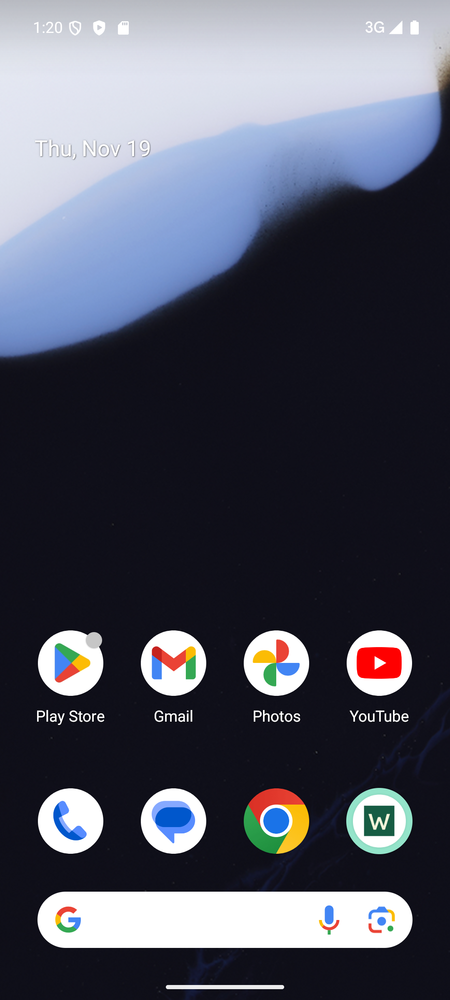 | 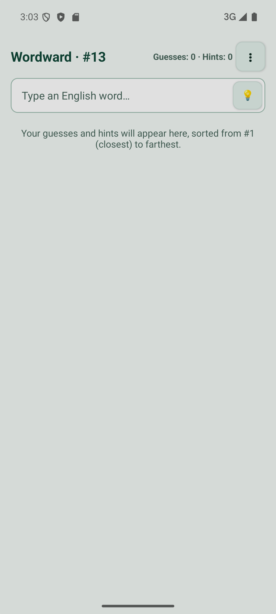 |

### 7.2 หน้าระหว่างเล่น การแยกคำล่าสุดกับรายการอันดับ การเน้นคำซ้ำ (`REPEAT`) และคำนอกคลัง (ภาพประกอบสำหรับรายงานส่วนที่ 2 ของ @Micosz)

| 1) หลายระดับอันดับ + คำใบ้ (`Latest: matrix #500` แยกจากรายการเรียงอันดับ `#63`, `#74`, `#500`, `#2500`) | 2) พิมพ์พหูพจน์ `books` ซ้ำกับ `book #74` (เน้นแถว `book #74` + ป้าย `REPEATED` โดยยอดคงเดิม 4 ครั้ง) | 3) พิมพ์คำนอกคลัง `notaword` (แจ้งเตือนคำนอกคลังโดยยอดคงเดิม 4 ครั้ง) |
|---|---|---|
| 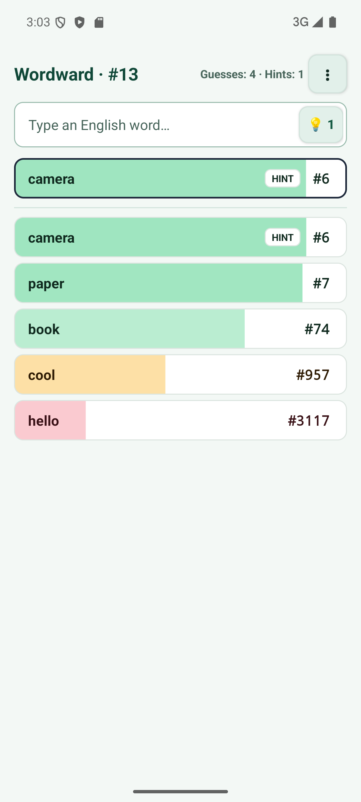 | 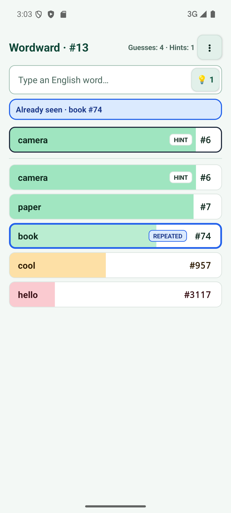 | 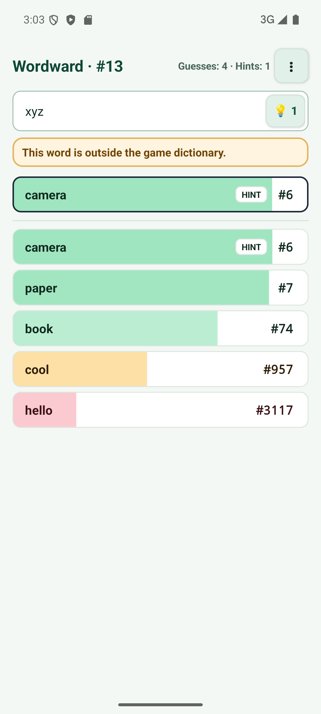 |

### 7.3 การสลับภาษา (ไทย–อังกฤษ) และการสลับธีม (Day / Night) โดยข้อมูลเกมยังอยู่ครบ (Rubric ข้อ 3.3 และ 3.4)

| สลับเป็นภาษาไทย (โหมดสว่าง · Day) ข้อมูลรอบทั้ง 4 คำยังอยู่ครบ | สลับเป็นโหมดมืด (ภาษาไทย · Night) ข้อมูลรอบและแถบสีปรับตามธีมมืดครบถ้วน |
|---|---|
| 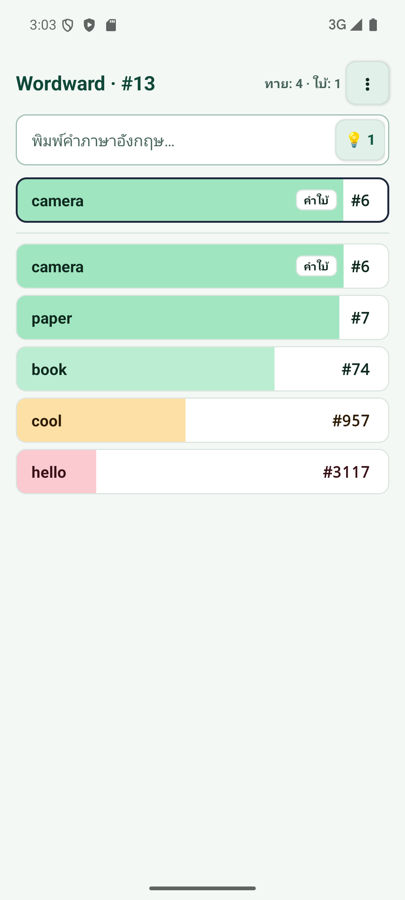 | 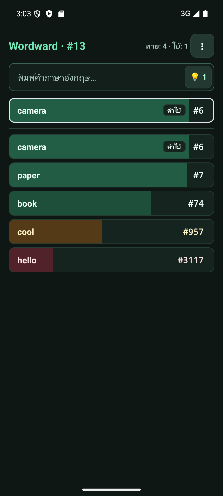 |

### 7.4 หน้าชนะอันดับ `#1` (สีทอง) และการทดสอบหน้าต่างยืนยัน "เริ่มรอบวันนี้ใหม่" กรณีกดยกเลิก vs กดยืนยัน (Rubric ข้อ 4.3 และภาพที่ 3 ของส่วนที่ 2)

| 1) ชนะด้วยรูปพหูพจน์ `mirrors` → แสดง `mirror #1` สีทอง 100% และปิดปุ่มเดา/ขอคำใบ้ | 2) กดปุ่ม "เริ่มรอบวันนี้ใหม่" แสดงหน้าต่างยืนยันข้อความไทยตามข้อตกลงทีม |
|---|---|
| 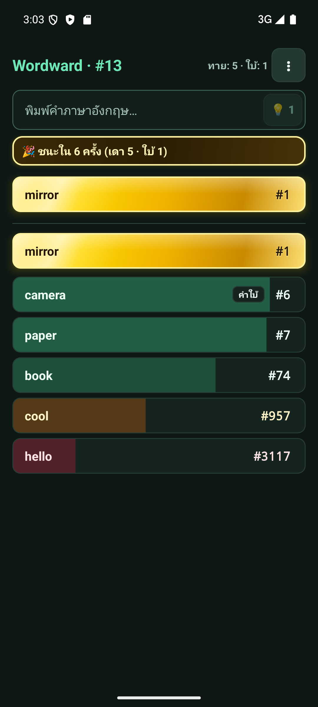 | 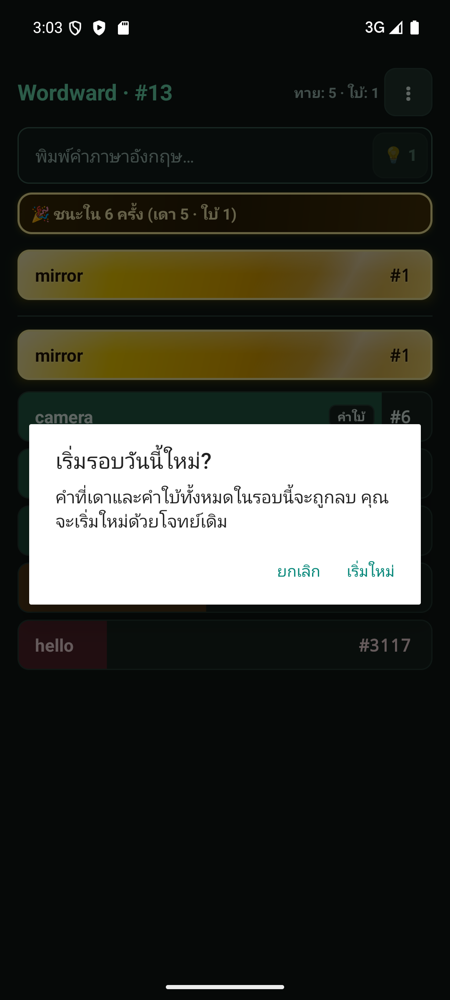 |

| 3) หลังกด **"ยกเลิก"**: สถานะชนะ คำลับ `mirror #1` และยอดรวม 5 ครั้งคงเดิมทุกประการ | 4) หลังกด **"เริ่มใหม่"**: ล้างประวัติและยอดกลับเป็น `0` ครั้งในโจทย์ `#13` เดิม ปุ่มเดาคำกลับมาใช้งานได้ |
|---|---|
| 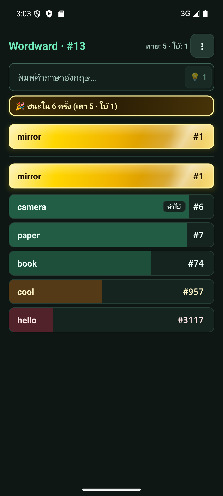 | 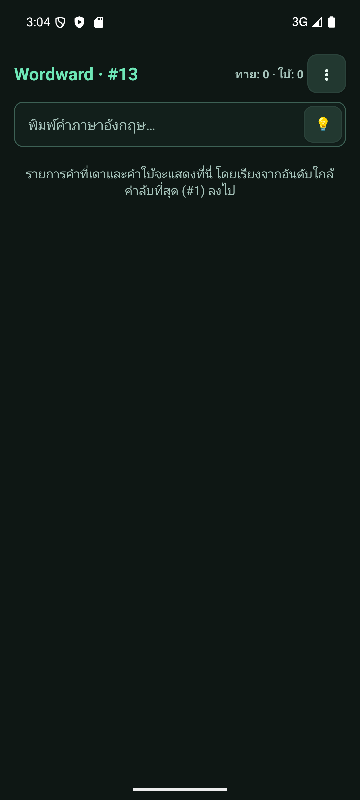 |

### 7.5 การรองรับการหมุนหน้าจอ (แนวนอน / Landscape) และหน้าจอขนาดเล็ก (`720 × 1280 @ 320 dpi`) (Rubric ข้อ 3.1 และ 3.2)

| แนวนอน (Landscape `2400 × 1080`) เลื่อนดูและกดปุ่มได้ครบไม่ซ้อนทับ | หน้าจอขนาดเล็ก (`720 × 1280 px`, `320 dpi`) ปุ่มทั้ง 3 บน Header และการ์ดไม่ตัดขอบ |
|---|---|
| 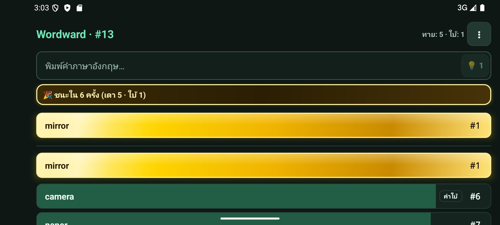 | 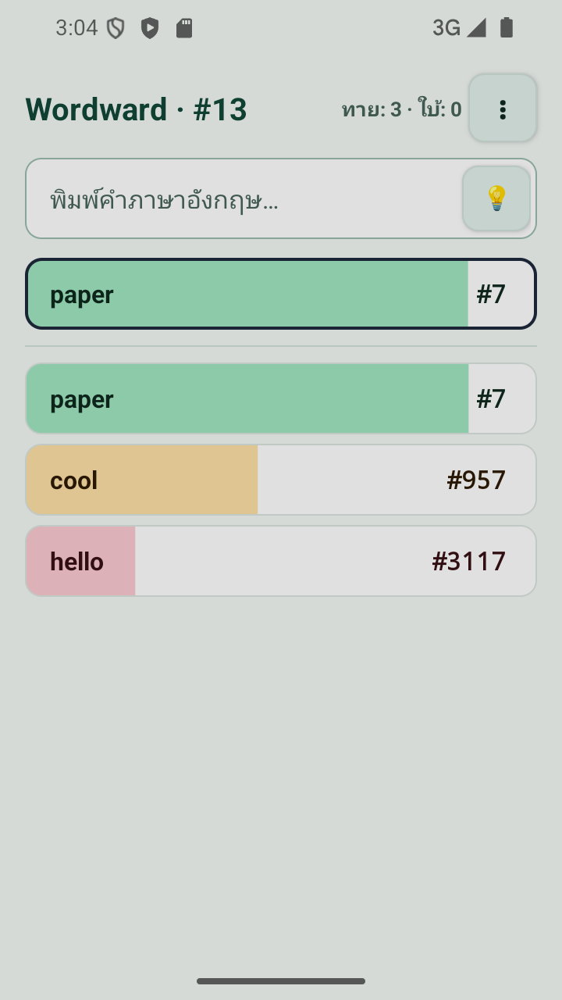 |
